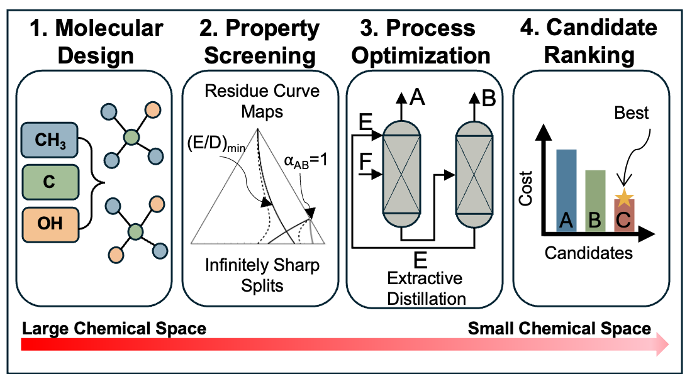

# CAMD-ISS

**Computer-Aided Molecular Design for Extractive Distillation using the Infinitely Sharp Split (ISS) Method**

[](LICENSE)
[](https://chemrxiv.org/doi/abs/10.26434/chemrxiv.15002406/v1)
[](https://www.python.org/)

<p align="center">
  
</p>

## Overview

Extractive distillation separates azeotropic and close-boiling mixtures by adding an entrainer that modifies relative volatilities. Classical entrainer selection criteria — selectivity and capacity at infinite dilution — ignore the recovery column and can miss feasibility constraints.

CAMD-ISS addresses this by coupling molecular design with the Infinitely Sharp Split (ISS) method, which simultaneously accounts for both the extractive and recovery columns. The framework:

- **Designs** new entrainer candidates via MILP-based molecular generation (UNIFAC group contributions)
- **Screens** predefined entrainer sets against thermodynamic and structural constraints
- Evaluates candidates using the **ISS objective** (minimum entrainer-to-distillate ratio *E/D*), computed via Pyomo/IPOPT
- Performs **miscibility screening**, **bubble-point VLE**, and **azeotrope detection** along the way

## Quick Start

```bash
# 1. Install IPOPT and dependencies
conda install -c conda-forge ipopt
pip install -e .

# 2. Run screening on a real system (no Gurobi required)
python iss.py config/IECR/screen_acetone_methanol.yaml -v

# 3. Or run the full design pipeline (requires Gurobi license)
python iss.py config/camd_minimal.yaml -v
```

## Installation

### Prerequisites

| Solver | Required for | License |
|--------|-------------|---------|
| [IPOPT](https://coin-or.github.io/Ipopt/) | VLE, ISS, Antoine (all modes) | Open source |
| [Gurobi](https://www.gurobi.com/) | Molecule generation (design mode only) | Commercial — free academic license available |

**Screen mode** only requires IPOPT.  
**Design mode** additionally requires a Gurobi license for MILP-based candidate generation.  
A free academic license is available at [gurobi.com/academia](https://www.gurobi.com/academia/academic-program-and-licenses/).

```bash
# Install IPOPT via conda (recommended)
conda install -c conda-forge ipopt

# Install package and dependencies
pip install -e .

# Optional: SMILES resolution for results (experimental resolve_smiles step)
pip install -e ".[smiles]"

# Optional: Jupyter notebooks (tutorials/, case_studies/)
pip install -e ".[notebooks]"

# Design mode only: Gurobi (requires a license)
pip install -e ".[design]"
grbgetkey <your-license-key>
```

## Usage

Both modes are driven by the same `iss.py` entry point — the mode is read from the config file's `mode` field — and produce CSV/JSON output.

### Design Mode — generate and screen candidates

```bash
python iss.py config/IECR/design_acetone_methanol.yaml -v
```

```yaml
mode: "design"

mixture:
  component_a:
    groups: {CH3: 1, CH3CO: 1}   # acetone
  component_b:
    groups: {CH3OH: 1}            # methanol

design:
  groups: ["CH3", "CH2", "CH", "C", "OH", "HCO", "DMSO", "DOH"]
  constraints:
    min_groups: 3
    max_groups: 6
    min_func_groups: 1
    max_func_groups: 2
    molecular_type: 1   # 1 = acyclic
```

### Screen Mode — evaluate predefined entrainers

```bash
python iss.py config/DA/screen_homo_acetone_methanol.yaml -v
```

```yaml
mode: "screen"

mixture:
  component_a:
    groups: {CH3: 1, CH3CO: 1}
  component_b:
    groups: {CH3OH: 1}

screen:
  entrainers:
    - name: "ethylene_glycol"
      groups: {DOH: 1}
    - name: "DMSO"
      groups: {DMSO: 1}
```

### Screening Pipeline

Both modes run the same 15-step pipeline:

| Step | Description |
|------|-------------|
| 1 | Validate binary mixture (structural check) |
| 2 | Check UNIFAC parameter availability |
| 3 | Calculate pure component properties (Constantinou-Gani) |
| 4 | Apply user property overrides |
| 5 | Calculate Antoine parameters (Pyomo/IPOPT) |
| 6 | Generate candidates (design) or load entrainers (screen) |
| 7 | Check UNIFAC parameters for all candidates |
| 8 | Calculate pure properties for candidates |
| 9 | Screen by pure property constraints (Tb, Tc, Pc, …) |
| 10 | Calculate Antoine parameters for candidates |
| 11 | Miscibility screening over temperature range |
| 12 | Bubble-point VLE calculations (ternary) |
| 13 | Screen by mixture property constraints (selectivity, azeotropes) |
| 14 | ISS calculation — minimize entrainer-to-distillate ratio *E/D* |
| 15 | *[Experimental]* Resolve UNIFAC group composition to a candidate SMILES structure |

Results are written to the configured `output.dir` as `results.csv` and `results.json`.

A UNIFAC group composition doesn't uniquely determine one molecule — different constitutional isomers can share identical group counts (and get identical estimated properties, since UNIFAC is blind to connectivity). When step 15 finds more than one isomer for a candidate, the `smiles` column lists all of them joined by `" | "` rather than picking one arbitrarily.

### Post-run Analysis

```bash
python analyze_screening_log.py results/IECR/design_acetone_methanol/iss_run_*.log -o rejection_reasons
```

Parses a screening log from either mode and breaks down *why* candidates were rejected — by pure-property constraint (Tb, Tm, Tc, Pc, Hv) at step 9 and by mixture constraint (azeotrope, miscibility, selectivity) at step 13 — printing counts and saving a bar chart (`-o` sets the base output name; both `.pdf` and `.png` are written). Useful for understanding which screening threshold is doing the rejecting, to help tune configs.

### Azeotrope Check (independent diagnostic)

```bash
python check_azeotrope.py config/IECR/screen_acetone_methanol.yaml -v
```

Standalone tool, separate from the design/screen pipelines. Reads only the `mixture:` section of any existing config file, solves for the binary A-B azeotrope via UNIFAC, and reports whether one was found (composition and temperature). Also plots xy and Txy diagrams with the azeotrope point marked, saved to `output.dir` if the config defines one. Uses a single initial guess (x=0.5, T=midpoint of Tb_A/Tb_B) — a root-finding problem, so it can miss an azeotrope far from that guess or fail to converge for a non-azeotropic pair. Pass `--no-plot` to skip plotting.

## Project Structure

```
camd_iss/
├── iss.py                     # Entry point (design/screen mode via config['mode'])
├── check_azeotrope.py         # Standalone binary azeotrope check + xy/Txy plots
├── analyze_screening_log.py   # Post-run rejection-reason breakdown + bar chart
├── config/
│   ├── camd_minimal.yaml         # Minimal working config template
│   ├── IECR/                     # Original CAMD-ISS framework case studies
│   └── DA/                       # Extended case studies (upcoming conference paper)
├── data/
│   └── json/            # UNIFAC parameters (rk, qk, interactions, Tc, Tb, …)
├── src/
│   ├── pipeline.py        # Shared 15-step pipeline
│   ├── unifac_reverse.py  # [Experimental] Group composition -> SMILES
│   ├── molecules/         # Structure validation and MILP generation
│   ├── pure/              # Property estimation and Antoine calculation
│   ├── mixture/unifac/    # UNIFAC, VLE, ISS (Pyomo/IPOPT)
│   └── data/              # Parameter loading and UNIFAC compatibility
├── case_studies/        # Analysis notebooks and worked examples
├── tutorials/           # Step-by-step Jupyter notebooks (01–10)
└── tests/               # Unit tests
```

## Tutorials

The `tutorials/` folder contains notebooks covering the full workflow:

| Notebook | Topic |
|----------|-------|
| `01_structures.ipynb` | UNIFAC group structures and validation |
| `02_pure_properties.ipynb` | Constantinou-Gani property estimation |
| `03_antoine.ipynb` | Antoine parameter determination (three methods) |
| `04_unifac.ipynb` | UNIFAC activity coefficient model |
| `05_vle_binary.ipynb` | Binary VLE calculations |
| `06_vle_ternary.ipynb` | Ternary VLE calculations |
| `07_azeotrope.ipynb` | Azeotrope detection |
| `08_iss.ipynb` | ISS optimization |
| `09_analyze_screening.ipynb` | Screening results analysis |
| `10_assemble_mol.ipynb` | *[Experimental]* UNIFAC group composition -> candidate SMILES (`src/unifac_reverse.py`) |

## Citation

If you use this software in your research, please cite the relevant paper(s):

**CAMD-ISS framework (IECR):**

```bibtex
@article{iss_camd2026,
  author  = {Adem R. N. Aouichaoui and Ivonne Rodriguez-Donis and Nataliya Shcherbakova
             and Edoardo Parascandolo and Vincent Gerbaud and Jens Abildskov},
  title   = {Computer-Aided Entrainer Design for Extractive Distillation Using Infinitely Sharp Splits},
  journal = {ChemRxiv},
  year    = {2026},
  doi     = {10.26434/chemrxiv.15002406/v1},
  url     = {https://chemrxiv.org/doi/abs/10.26434/chemrxiv.15002406/v1},
}
```

**Extended case studies (DA conference paper):** citation to be added once published.

## Acknowledgements

This work originated as an M.Sc. thesis by Adem R.N. Aouichaoui under the supervision of Assoc. Prof. Jens Abildskov at the [Process Systems Engineering Center (PROSYS)](https://www.kt.dtu.dk/english/research/prosys), Technical University of Denmark (DTU).


## Development

```bash
pip install -e ".[dev]"
pytest tests/ -q
```

## Contributing

Issues and pull requests are welcome. Please open an issue first to discuss proposed changes.

## License

GNU General Public License v3. See [LICENSE](LICENSE) for details.
